<p align="center">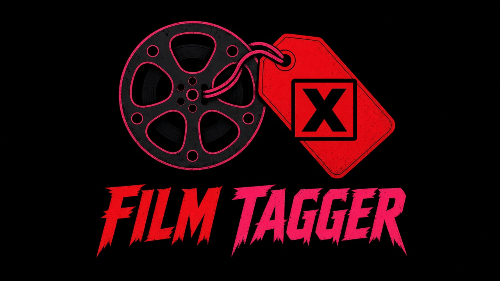</p>

# Film Tagger

**A private, local web app for cataloguing and richly tagging your own film and scene collection.**
Point it at the folders where your video files live. It builds a searchable catalogue with posters and metadata, and lets you tag films in as much detail as you like, by hand or with help from AI. It runs entirely on your own computer. It is a catalogue, not a video player.

> **New to this? See [INSTALL.txt](INSTALL.txt)** for step-by-step Windows setup: download `FilmTaggerSetup.exe`, double-click, done. No Python install or admin rights needed.

**Contents:** [What's new in v1.2.0](#whats-new-in-v120) · [What's new in v1.1.2](#whats-new-in-v112) · [What's new in v1.1.1](#whats-new-in-v111) · [Porn Scenes features](#porn-scenes-features) · [At a glance](#at-a-glance) · [Quick start](#quick-start) · [Feature guide](#feature-guide) · [Screenshots](#screenshots) · [Install](#install) · [Privacy](#privacy) · [Release history](#release-history) · [License](#license)

## What's new in v1.2.0
Better posters for Movies, a Find Gallery that learns from you, and gallery downloads that cope with the real world.

### 🖼 Find Posters
- **Browse every TMDB poster** for a Movies or Classic Porn film: open the film and click **🖼 Find Posters**. English and no-language posters come first, then the best-rated, with language, size and votes under each one. It uses the film's existing TMDB id, so there is no searching and only one TMDB request.
- **Click a poster to use it.** The full-size image is downloaded and saved as a **hand edit**, so later TMDB fetches never replace it.
- **↶ Restore previous poster** puts back what the film had before your last pick. Nothing is deleted: replaced posters are kept in `posters/backup/`.

<p align="center">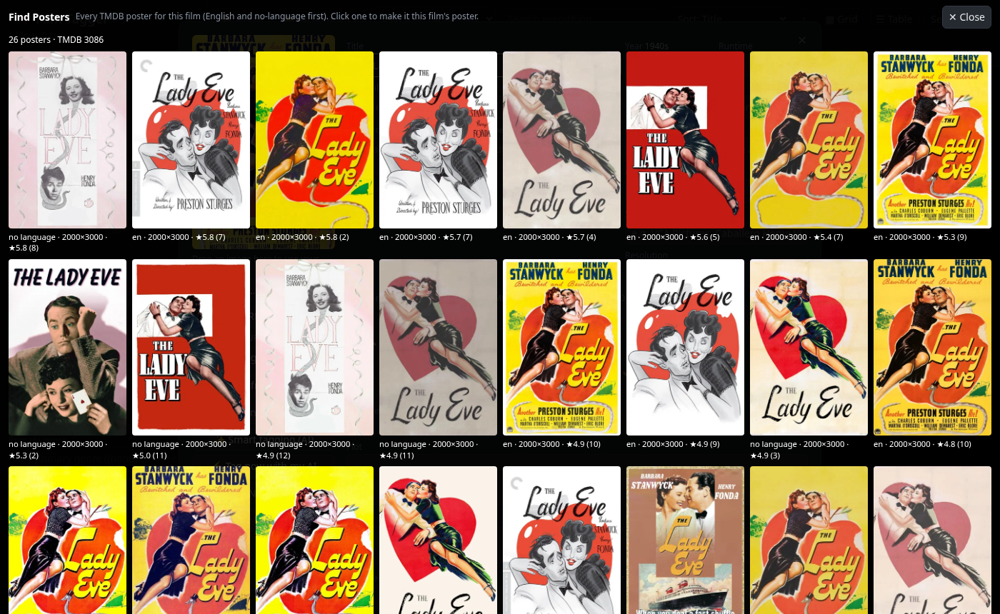</p>

### 🧠 Find Gallery learns from the threads you paste
- When you **paste a ViperGirls thread URL** and click **Download**, Film Tagger reads that thread once and learns how ViperGirls posts the studio: the **prefix** it really uses, and whether its **thread titles leave performer names out**.
- Later searches for that studio try the learned prefix first (then the usual one), and for studios whose titles skip names they move straight to **prefix + last names** and aliases. The search panel shows the rule it used.
- Rules are learned **only from links you paste by hand**, never from automatic results, and a newer link replaces the old rule. View and delete them in **Library & Settings → Learned ViperGirls rules**.

### ⬇️ Gallery downloads that survive hiccups
- **Per-file hiccups no longer stop a download:** a photo that vanishes or is renamed while the folder is being checked is skipped, and gallery-dl is never left running on its own after an error.
- **Long folder names are shortened safely:** when `<video name> - GALLERY` would get close to the Windows 260-character path limit, the gallery gets a shortened, stable name (`<start of name>~<short hash> - GALLERY`). Existing long-named galleries are still found and used.
- **Resume by re-pasting the thread:** paste the same link again and choose to download into the existing gallery. Photos you already have are kept and the missing ones are added.

### 📷 Huge photos as posters
**Use this image** (From Gallery) and **poster upload** now accept big camera photos up to 200 MB. Anything over 15 MB is saved as a **2000 px JPEG copy** (aspect ratio kept); the original file is never changed.

> The Find Posters screenshot comes from a demo instance with one mainstream film, *The Lady Eve* (1941), and its real TMDB posters.

## What's new in v1.1.2
- **Studio click fixed:** clicking a studio finds all its scenes, including names with apostrophes, spelling variants and scenes matched only by folder.
- **Removed stays removed after moves:** a removed scene is recognised by name + size even after its file moves to another folder or drive.
- **Better removed-items list:** sorted by studio, then first performer, then date, and showing studio and performers. Removing a scene now saves its studio, cast and date.
- **Scans fill a blank studio** from the folder the scene is in.
- **Sturdier gallery downloads:** downloads keep going past failed images, retry only the failed links, de-duplicate sets that were posted twice, show an accurate failed count and skip dead image hosts.
- **Real Porn Scenes screenshots** in the README, captured and censored by the author.

## What's new in v1.1.1
A reliability and polish release for Scenes libraries, focused on Find Gallery, gallery downloads and studios.

### 🔎 Find Gallery that never hangs
- **Hang fix:** every forum request has a timeout, the panel shows live progress (*Step 2 of 5: "Ava Stone" with prefix…*, with a seconds counter), a **Retry** button appears on any failure, and the whole search gives up cleanly after **3 minutes**.
- **Searches ViperGirls' *Adult Photo Sets* only** (and its sub-forums), never the whole site.
- **Smarter search order:** each performer **alone** first (thread titles often leave out co-stars), then their **aliases** (from your library or ThePornDB), then **performers + studio**, and finally a **last-name fallback** with the studio prefix, labelled *last-name match* and ranked below full-name hits.
- **Never searches by title**, and scenes without a ThePornDB match use only performer names you already know.

<p align="center">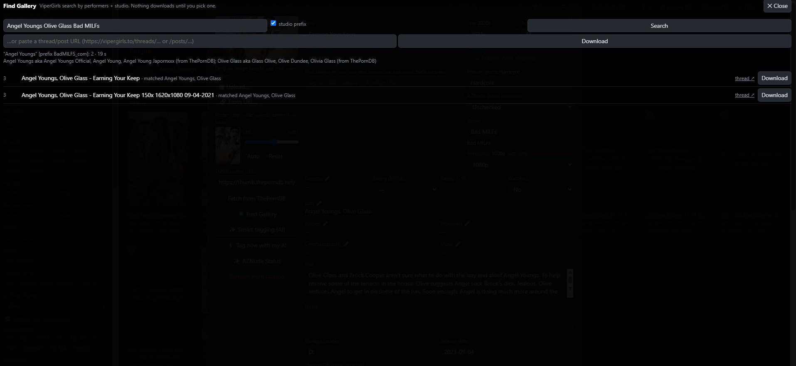</p>

### ⬇️ Gallery downloads that finish
- **gallery-dl runs as a separate process with a log file**, which fixes the freeze where a download stalled at 0 files.
- **Post links are normalised** to `threads/<id>?p=<post>`; if a reply post has no images, the **whole thread** is tried automatically.
- **Dead sets are detected** (only "image removed" placeholders) and stopped early; placeholder and tiny files are cleaned up.
- **Dead image hosts are skipped:** hosts that no longer resolve (DNS failure) are left out and the rest of the set is still downloaded, with a note naming the skipped hosts.
- When it finishes, the scene's 📷 badge and **From Gallery** poster picker update straight away.

<p align="center">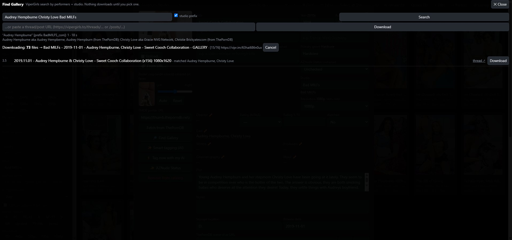</p>

<p align="center">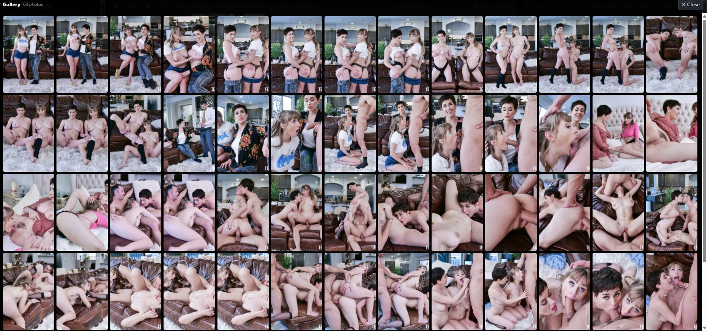</p>

### 🎯 ThePornDB Fetch on matched scenes shows choices
Clicking **Fetch from ThePornDB** on a scene that is already matched no longer silently re-applies the match. It shows the candidates with your **current match** marked at the top, so you can keep it or switch with **Use**.

<p align="center">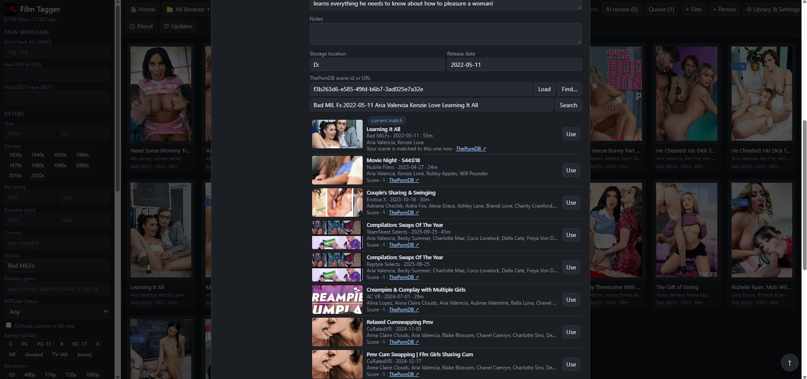</p>

### 🏷️ Related studios
In **Library & Settings → Related studios**, link a sub-label to its parent studio (e.g. *Northwind Classics* ⇐ *Northwind Pictures*). ThePornDB matching counts either as the same studio, a match never changes your studio to the other label, and nothing is renamed.

<p align="center">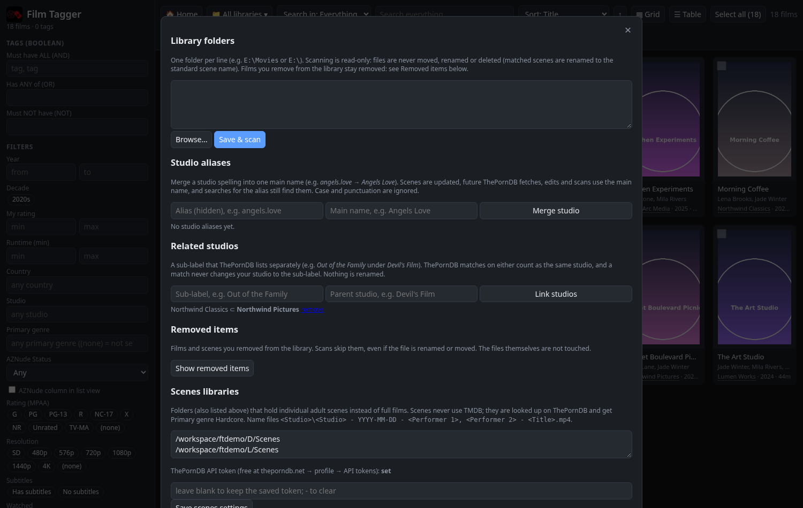</p>

### 🎬 Porn Scenes library
- **Studio sort** groups by studio, then the **first performer**, then **newest first**.
- **Performer names on cards**, under the title.
- **Studio click fixed:** clicking a studio finds all its scenes even with apostrophes, spelling variants or scenes that only match by folder.

<p align="center">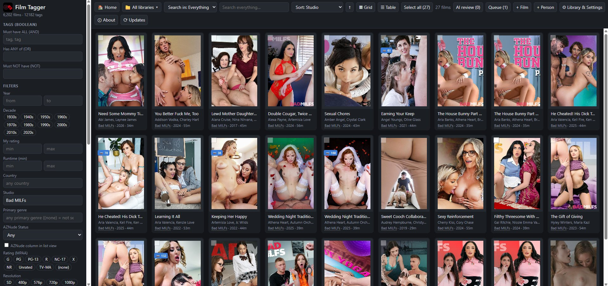</p>

### 💽 Multiple scene roots, one library
- Scene folders on several drives (e.g. `D:\Porn Scenes` and `L:\Porn Scenes`) are shown as **one library**, with studio sub-folders merged.
- **Cross-drive move guard:** renames never move a file to another drive.
- **Removed stays removed after a move:** a removed scene is recognised by name + size even after it moves to another folder or drive.
- **Scans fill a blank studio from the folder** the scene sits in.

<p align="center">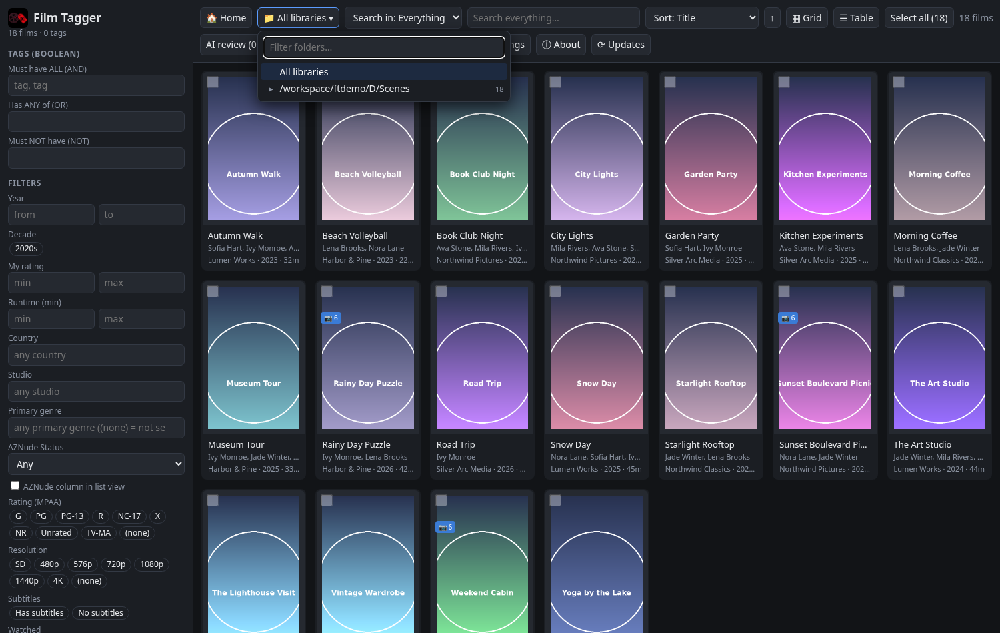</p>

> The Porn Scenes screenshots were captured and censored by the author from his own library. The settings and library-picker screenshots come from a demo instance with network access off.

## At a glance
| | |
|---|---|
| 📚 **Catalogue** | Recursive scans of any folders or drives, posters, rich metadata, grid and table views, fast with 10,000+ items |
| 🏷️ **Tags** | Unlimited tags in your own categories, ALL / ANY / NOT search, primary genres, saved searches |
| 🎞️ **Scenes** | ThePornDB matching, standard file names, Fix all, studio and performer aliases, related studios |
| 📷 **Galleries** | `<video> - GALLERY` folders, From Gallery posters, Find Gallery search and gallery-dl downloads |
| 🧠 **AI** | Optional smart tagging with any chatbot (no key) or any OpenAI-compatible API |
| 🖼️ **Smart crop** | On-device face detection centres 2:3 posters on the people |
| 🔒 **Private** | One local SQLite file, localhost only, no account or telemetry |

## Quick start
1. Install (Windows: run `FilmTaggerSetup.exe`; see [Install](#install)) and open http://localhost:5050.
2. **Library & Settings → Library folders:** add your film folders and click *Save & scan*.
3. Optional: add a free **TMDB key** for film posters and metadata, and a **ThePornDB token** plus **Scenes libraries** for adult scenes.
4. Tag away: open any title, add tags, or queue titles for **Smart tagging**.
5. For scenes: **Fetch from ThePornDB**, then **🔎 Find Gallery** to find and download a photo set into the scene's gallery folder.

## Feature guide
### Library
- **Library scan:** recursively finds video files (mkv, mp4, avi, mov, wmv, m4v, mpg, ts, webm, vob, …) in any folders or drives and guesses the title and year from file or folder names. Rescans add new files and flag missing ones. Film libraries are **read-only**: those files are never moved, renamed or deleted. (Scenes libraries can rename files; see below.)
- **Removed items stay removed:** deleting a film or scene from the catalogue remembers it, so rescans skip it even if the file is later renamed or moved. *Show removed items* in Library & Settings lists them and can bring them back. The files themselves are never touched.
- **Rich records:** title, original and alternative titles, year, country, director, cast, studio, runtime, plot, poster, MPAA rating, resolution, subtitles, your 1–10 rating, watched flag, notes, storage location and file paths. Everything is editable.
- **Poster grid and sortable table**, fast with 10,000+ items. Scene cards show a studio line (studio · date · runtime).
- **Back to top:** a floating ↑ button appears in the grid, on person profiles and in long dialogs once you scroll down.
- **About and Check for Updates:** *ⓘ About* in the toolbar shows the version, author, links and data credits. *⟳ Updates* checks GitHub for a newer release and shows its notes with a link to the release page; nothing is downloaded or installed automatically. A quiet check at startup puts a small dot on the button when an update is out.
- **Backup / restore** as JSON or CSV.

### Tags, genres and search
- **Unlimited tags** with user-editable categories (Genre, Content, Themes, Mood, Setting, Era…), autocomplete and bulk add/remove. **The category you choose when adding a tag wins:** tag names are unique, so picking a different category moves that tag (for every film that has it). AI and CSV imports never change a tag's category.
- **Primary genre:** one main genre per film. In the Edit window it is free entry: pick from the list or type a new genre, which is then remembered for the list and the sidebar filter. A value you set by hand is locked; TMDB, *Fill missing Primary Genres* and smart tagging never overwrite it. Films in a *Classic Porn* folder are only ever auto-filled with Hardcore or Softcore, but you can set any value by hand.
- **Powerful search:** tag logic (ALL / ANY / NOT), text search in any field (accent-insensitive, including alternative titles), filters for year, decade, country, studio, primary genre, rating, runtime, watched, MPAA, resolution, subtitles and library folder. Searches can be saved, and Back/Forward history works for every filter.
- **Country, studio and decade links** show every film from that country, studio or decade. *Fill missing countries / studios* backfill older records from TMDB; values you edit are never overwritten.
- **Resolution** is auto-detected from the video files (ffprobe if installed, otherwise a built-in reader, otherwise the filename). **Subtitles** are detected from sidecar files (.srt, .ass, …) and embedded streams, and can be edited by hand.
- **Runtime from the files:** an empty runtime is filled from the video's real duration (ffprobe if installed, otherwise the MP4/MKV/AVI header) after every scan. Runtimes you edit by hand are never overwritten.

### Scenes libraries and ThePornDB
Mark one or more folders as **Scenes libraries** (Library & Settings) for individual adult scenes instead of full-length films. Scenes never use TMDB; they are looked up on [ThePornDB](https://theporndb.net) and get Primary genre Hardcore.
- **Matching:** *Fetch* looks a scene up from its file name and applies confident matches automatically. **Find…** opens a candidate picker in the Edit window with the best matches (studio, date, runtime, performers and score) and a search box; **Use** applies one. A ThePornDB scene id or URL can also be pasted and loaded directly.
- **Review unmatched** lists every scene without a ThePornDB match with its top candidates, ready to pick.
- **Standard file names:** on *Use*, *Fetch*/*Load* and on **Save** (when studio, date, performers or title changed), the file and its same-name sidecars move to `<Studio>\<Studio> - YYYY-MM-DD - <Performers> - <Title>.<ext>`. Windows-illegal characters are removed, nothing is overwritten (` (2)` is appended), junk double extensions like `.mp4 - EPORN.mp4` are cleaned, the catalogue path is updated, an emptied old studio folder is removed (never `_No Studio`) and every move is logged to `_filmtagger_renames.csv` in the scenes folder. Scenes missing studio, date or title are left alone with a note.
- **Fix all file names** (Library & Settings) shows every planned rename (current → new) with a count first, then applies them with the same rules. Scenes with **`[Hold rename]`** in their notes are skipped (useful for shaky matches); remove the marker to include them again.

### Scene photo galleries and Find Gallery
- **Galleries:** a folder named `<video stem> - GALLERY` beside a scene's video is its photo gallery. Scenes with one show a 📷 badge with the photo count; **📷 From Gallery** in the Edit window uses any photo as the poster. *Fix all* moves the gallery with its video and scans never catalogue gallery photos as films.
- **Find Gallery** (🔎 in the Edit window) searches ViperGirls' *Adult Photo Sets* as a guest (no login). Searches are throttled (one at a time, at least 20 s apart), cached, time-limited (3 minutes) and shown step by step. Results are text only, ranked by performers and studio found plus a small boost for a close release date. You can edit the query, untick the studio prefix or paste a thread or post link.
- **Downloads** run [gallery-dl](https://github.com/mikf/gallery-dl) into the gallery folder with a live file count and **Cancel**. Nothing downloads until you click **Download**; adding to an existing gallery asks first. Scenes marked *Review by hand* are blocked from searching and downloading.
- **Learned ViperGirls rules:** a thread link you paste teaches Find Gallery the studio's real prefix and whether its titles name performers; manage the rules in Library & Settings. Long gallery folder names are shortened safely, and re-pasting a thread resumes a download.

### Libraries on several drives
- Several Scenes library folders (e.g. on `D:` and `L:`) appear as one library in the picker and filters.
- Renames stay on the drive the file is on; removed scenes stay removed even after they move (matched by name + size); scans fill an empty studio from the folder name.

### Posters
- **🖼 Find Posters** lists every TMDB poster for a Movies or Classic Porn film; your pick is a protected hand edit, with **↶ Restore previous poster** to undo.
- **Custom posters** by upload, URL, drag and drop or **From Gallery**; photos over 15 MB are saved as a 2000 px copy.

### People
- **Person profiles** for every actor, director, writer, producer, cinematographer and composer: photo, dates, bio and full filmography. Mainstream people come from TMDB ("You have 23 of 87", *Only films I have*); adult performers from ThePornDB (aliases, measurements, career, links), with the TMDB filmography kept when one exists.
- **Complete scene lists:** a performer's ThePornDB scenes are loaded page by page in the background (with progress) and cached, so performers with thousands of scenes show the true total. All your own scenes for that person are listed first as **In library**, linked by name, ThePornDB alias or scene id; the rest show 200 at a time with *Load more*. Scenes have their own *Only scenes I have* toggle.
- **Re-link** a person to a different ThePornDB performer or TMDB person by id or URL, or go back to automatic matching.
- **+ Person** adds someone by hand (name, photo, bio, links), for people neither service knows.

### Metadata and AI
- **Optional TMDB metadata:** with a free key it fetches posters, cast, plot, runtime, genres, studios and countries for one film or the whole library, and fills in MPAA ratings. Your own poster art (upload, drag-and-drop or URL) is never replaced.
- **Smart tagging (AI):** queue films and let an AI suggest tags and a primary genre. Every suggestion waits for your approval. Two ways:
  - **No key needed:** copy the ready-made prompt into any AI chatbot and paste back its JSON reply.
  - **Bring your own key:** connect any OpenAI-compatible API (OpenAI, OpenRouter, xAI, or local Ollama / LM Studio) for one-click "Tag now".
- **AZNude Status** per film (see below).

## Porn Scenes features
Screenshots captured and censored by the author from his own Porn Scenes library.

**Home screen**

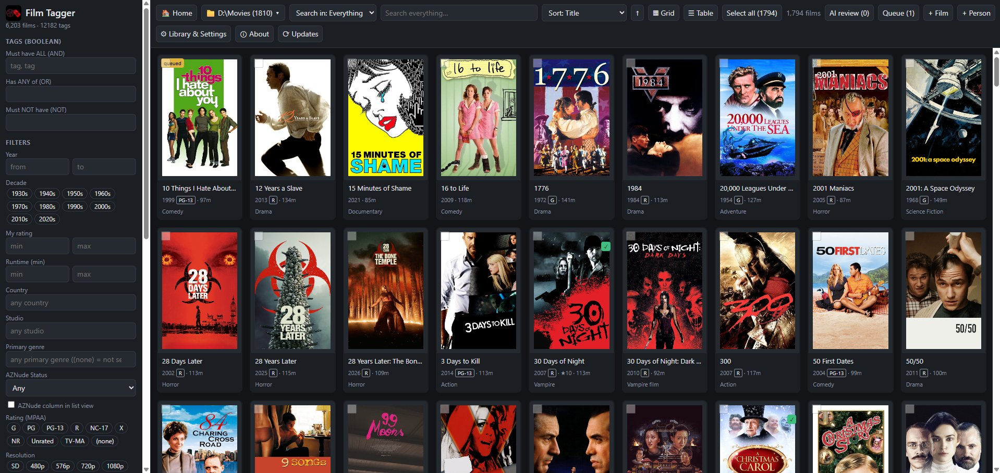

**One studio (scenes sorted by performer)**


**Smart crop (performer automatically centered)**

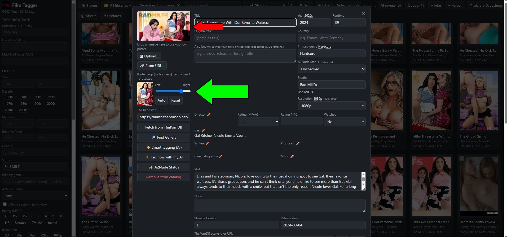

**Scene edit window**

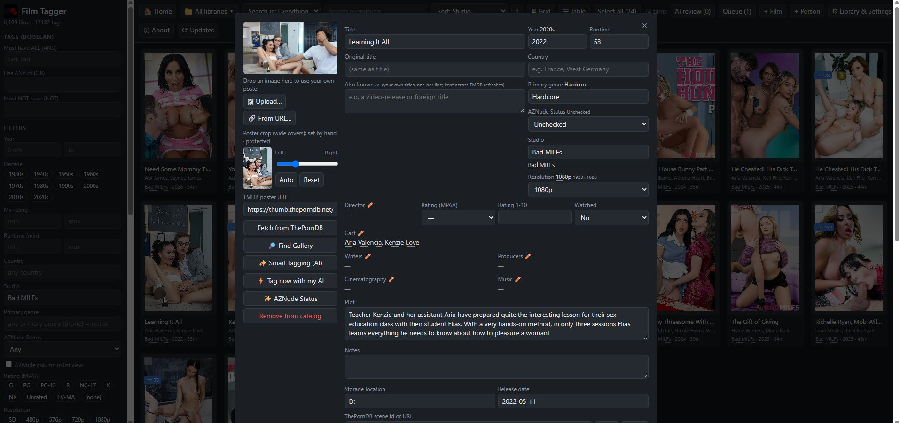

**ThePornDB choices**


**Find Gallery results**


**Gallery downloading**


**Freshly downloaded gallery**


## Screenshots
The v1.2.0 Find Posters screenshot is in [What's new in v1.2.0](#whats-new-in-v120) and the v1.1.1 screenshots in [What's new in v1.1.1](#whats-new-in-v111) above.
Movie screenshots show real mainstream titles and their TMDB posters from the author's own Movies library, copied into a separate demo instance (no adult titles). The Porn Scenes screenshots were captured and censored by the author. The smart-crop screenshots (v1.0.43) use made-up titles and abstract artwork.

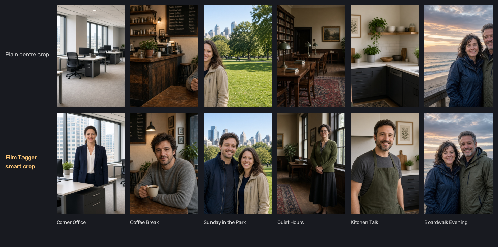

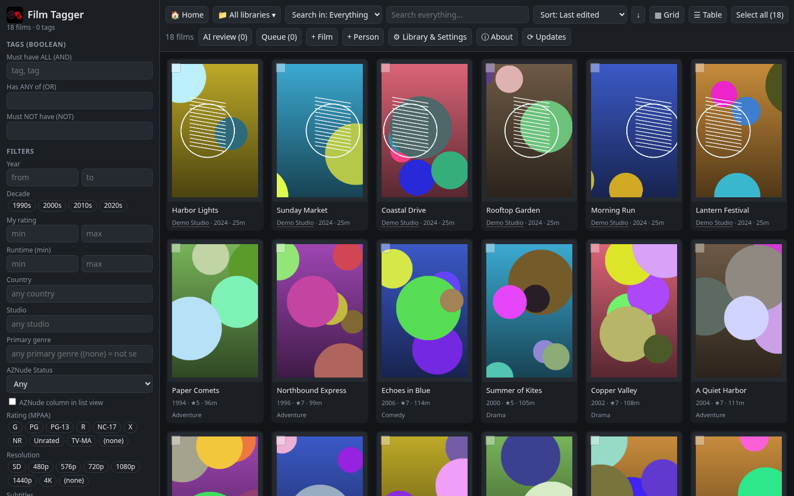

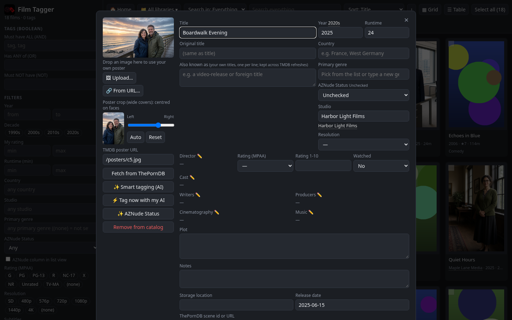

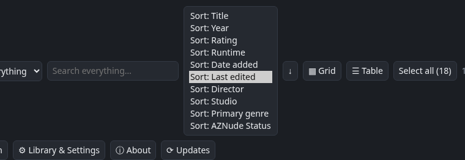

Library grid:

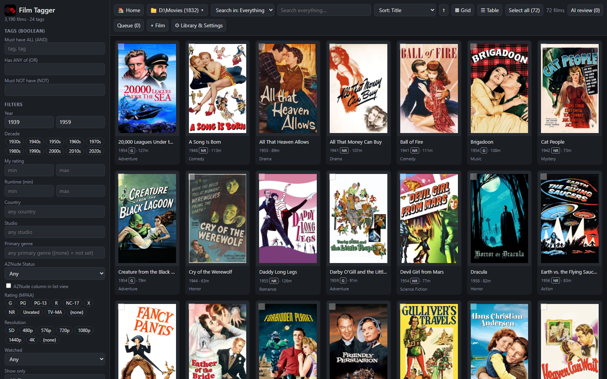

Table view with tags, genre, studio, resolution and MPAA columns:

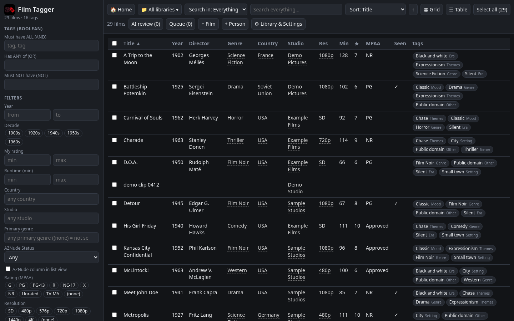

Edit window for a film:

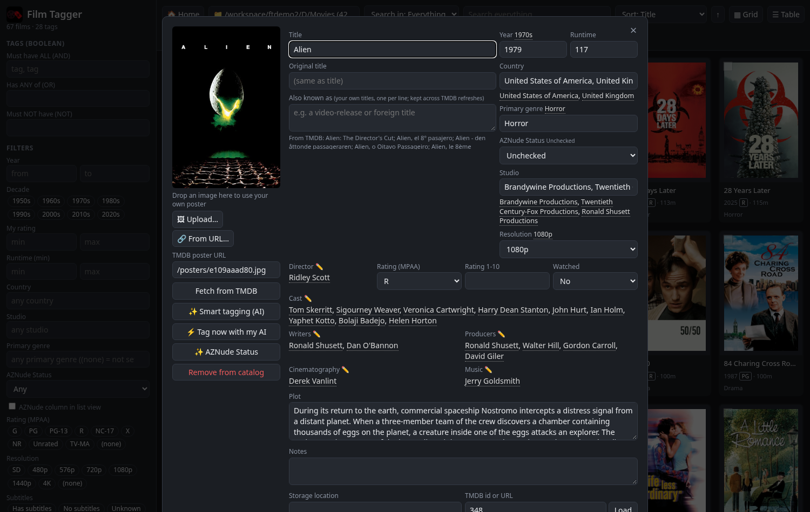

AI tag review: suggestions wait for your approval:

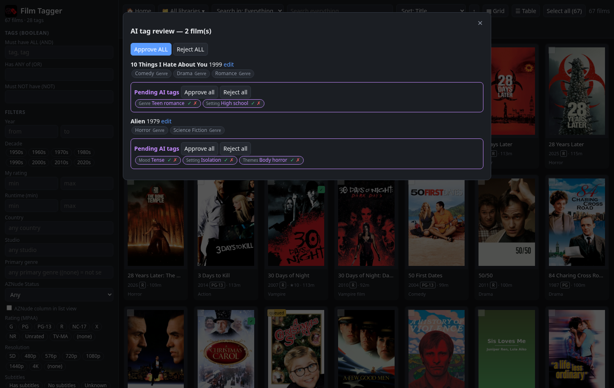

Person profile (library-only mode, no TMDB key):

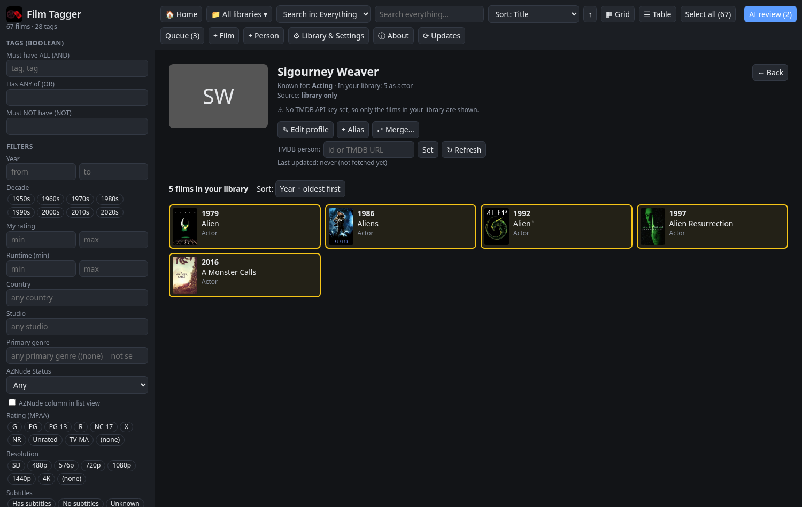

Library & Settings:

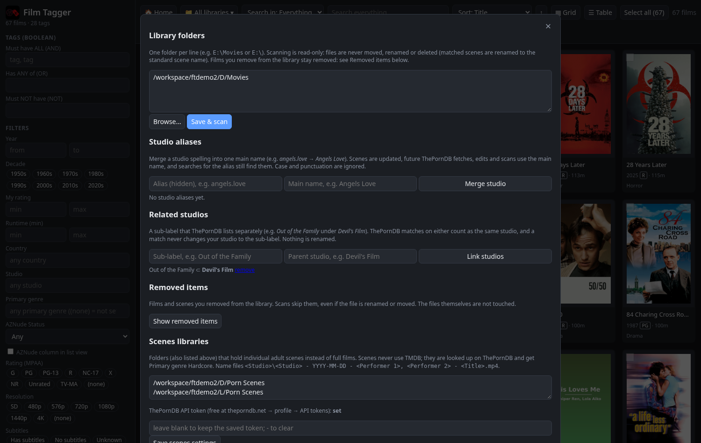

Scenes libraries, ThePornDB token and Fix all scene file names:

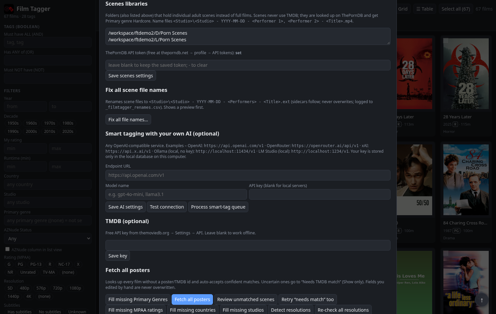

## Install
- **Windows (recommended):** download **`FilmTaggerSetup.exe`** from the [latest release](https://github.com/kylerhudson1975/film-tagger/releases/latest) and run it. It installs per user into `%LOCALAPPDATA%\Film Tagger` with a bundled Python 3.12, so no admin rights are needed. It adds Start Menu and (optionally) Desktop and sign-in shortcuts and an entry in *Apps* for uninstalling. Your library (`films.db` + `posters/`) lives in `%LOCALAPPDATA%\Film Tagger\data`. See [INSTALL.txt](INSTALL.txt).
  - Silent install: `FilmTaggerSetup.exe /S [/D=C:\path] [/NODESKTOP] [/STARTUP] [/PORT=5051]`. Silent uninstall (keeps the library): `uninstall.exe /S`.
  - Build the installer yourself on Linux: `installer/build_installer.sh` (needs `makensis`, `pip`, `curl`, `unzip`) → `dist/FilmTaggerSetup.exe`.
- **Windows (manual):** install Python 3, unzip the source, double-click `Install Film Tagger.bat`.
- **Mac / Linux:** `python3 -m pip install -r requirements.txt`, then `python3 app.py`, then open http://localhost:5050.

### Updating
Run the newer `FilmTaggerSetup.exe` over the existing install (close Film Tagger first, or use *Stop Film Tagger*). Your library and settings are kept, and the database is upgraded automatically on first start. For a source install, replace the program files (not `films.db` or `posters/`) and restart. A copy of `films.db` before updating is a good habit.

### ThePornDB API token (for Scenes libraries)
1. Create a free account at [theporndb.net](https://theporndb.net).
2. Open your profile → **API tokens** and create a token.
3. In Film Tagger open **Library & Settings → Scenes libraries**, paste the token and click *Save scenes settings*. Leave the field blank later to keep the saved token, or enter `-` to remove it.

The token is stored only in your local database. Never share it or put it in a screenshot or issue.

### TMDB API key (optional)
Free from themoviedb.org → Settings → API. Paste it under **Library & Settings → TMDB**. Without a key the app works offline with what is in your library.

## Smart tagging from the command line
```
python smarttag.py export-queue queue.json     # films you queued, as JSON
python smarttag.py import-tags tags.json       # AI reply -> pending tags for review
```
Reply format: `[{"film_id": 12, "tags": [{"name": "heist", "category": "Themes"}]}]`. See [SMART_TAG_PROMPT.txt](SMART_TAG_PROMPT.txt) for the full prompt.
REST equivalents: `GET /api/queue/export`, `POST /api/queue/import`, `GET /api/pending`, `POST /api/pending/review`.

## Privacy
- Everything stays on your computer in one SQLite file (`films.db`, plus a `posters/` folder for custom art). There is no account, telemetry or cloud service.
- The app only listens on `localhost` and rejects requests from other websites.
- Network requests only happen when **you** use them:
  - TMDB lookups, if you add a TMDB key;
  - ThePornDB lookups for Scenes libraries and adult performers, if you add a ThePornDB token;
  - ViperGirls (guest search) and the image hosts of a set, only when you use Find Gallery or click Download;
  - your chosen AI provider, if you set one up. Only the film's title, year, director, file path, a short plot and its existing tags are sent.
- API keys are stored only in your local database.

## Tech
Python 3 + Flask + SQLite, with a single-page HTML/JS front end. There is no build step. Dependencies are in `requirements.txt` (ffprobe is used for resolution and subtitle detection if installed). Find Gallery runs [gallery-dl](https://github.com/mikf/gallery-dl) as a separate program; see [THIRD_PARTY.md](THIRD_PARTY.md).

## Release history
<details><summary>Older release notes (v1.0.43 to v1.1.0)</summary>

### New in v1.1.0
- **Scene photo galleries:** put a scene's photo set in a folder named `<video stem> - GALLERY` beside the video and Film Tagger links it to the scene. Scenes with a gallery show a 📷 badge with the photo count, and the Edit window's **📷 From Gallery** picker lets you use any photo as the poster. *Fix all* file names moves a gallery folder along with its video, and scans never catalogue gallery photos as films.
- **Gallery re-check:** opening a scene's Edit window looks for its gallery again, so a folder added or removed outside the app is picked up straight away.
- **🔎 Find Gallery:** searches ViperGirls as a guest (no login) by the scene's performers plus the studio's prefix tag, falling back to one performer at a time and then performers plus studio as plain text. Results are text only, ranked by how many performers and the studio appear plus a small boost for a close release date. The query is editable and you can paste a thread or post link. Searches are throttled (one at a time, at least 20 s apart) and cached. Nothing downloads until you click **Download**, which runs [gallery-dl](https://github.com/mikf/gallery-dl) into the scene's gallery folder with a file count and **Cancel**, removes placeholder/tiny files and asks before adding to an existing gallery. Scenes marked *Review by hand* are blocked from searching and downloading.
- **Remove from catalog** keeps your scroll position.

### New in v1.0.46
- **Studio aliases:** the same studio often turns up under different spellings (e.g. *angels.love* from ThePornDB and *Angels Love* from file names). Map any spelling to one main name; case, accents and punctuation are ignored. The alias stays hidden but still works: studio filters and searches for it find the main name, ThePornDB matching treats it as the same studio, and every write (ThePornDB fetch, manual and bulk edits, TMDB studio fill, scans) saves the main name, so a later fetch never undoes the merge.
- **Studio aliases in Library & Settings:** type the alias and the main name and click *Merge studio*. After a confirmation, existing scenes are updated. Each alias is listed with a *remove* link (scenes keep the main name).
- **Tidy folders with Fix all:** after a merge, the scene renamer's *Fix all* preview shows matched scenes moving from the old spelling's folder into the main studio folder (e.g. `angels.love\` to `Angels Love\`). Nothing moves until you apply it.

### New in v1.0.45
- **Performer aliases everywhere:** performers often work under different names at different studios. Cast, People and Everything searches now match any of a performer's aliases (from ThePornDB or added by you), and a person page includes scenes and films credited under every alias.
- **+ Alias:** add another name for a person straight from their page. Hand-added aliases are kept when the profile is refreshed.
- **Merge with undo:** found the same performer twice? *⇄ Merge…* folds one person into the other after a confirmation. The other name becomes an alias, cast credits keep working, your files and cast lists are not changed, and each merge can be undone from the person page.
- **Alias-aware ThePornDB matching:** a file name that credits a performer under an alias now counts as a performer match.

### New in v1.0.44
- **Much faster ThePornDB matching:** searches now run in parallel, so finding a scene takes seconds instead of close to a minute.
- **ThePornDB search box always visible** in the scene edit window, prefilled with the title: tweak it and press Enter.
- **Smarter default sort:** picking the Porn Scenes library sorts by Studio; other libraries sort by Title.
- **Cleaner titles:** double quotation marks (straight, curly and « ») are removed anywhere in a scene title; apostrophes are kept.

### ✨ New in v1.0.43: smart-crop posters
Most library apps squeeze a wide cover into a poster slot with a blind centre crop, so the people end up cut in half. Film Tagger looks at the picture first.
- **Smart-crop posters for Scenes:** Film Tagger takes the full-width studio cover, finds the faces with an on-device face detector (YuNet, MIT licence; falls back to a person detector, then to the most detailed area) and centres the 2:3 poster on the people. It runs in the background whenever a cover changes; on the author's own library it re-centred 545 posters automatically. Images are analysed in memory only, nothing leaves your computer.
- **Focus slider with live preview:** not happy with a crop? Drag the Left/Right slider in the edit window and the poster updates live, in the dialog and in the grid behind it. *Auto* re-detects, *Reset* centres, and your hand-set value is never overwritten.
- **Sort: Last edited:** jump straight back to whatever you touched most recently, whether that was a tag edit, a poster change or a metadata refresh.
- Scene titles wrapped in quotation marks are cleaned up automatically, and the smart-tag prompt no longer adds Cum/Semen to all-girl films.

<p align="center"></p>

</details>

## License
[MIT](LICENSE) © 2026 Kyle R. Hudson & Grok Bot

Third-party software: [gallery-dl](https://github.com/mikf/gallery-dl) © Mike Fährmann, [GPL-2.0](https://github.com/mikf/gallery-dl/blob/master/LICENSE), installed alongside the app and run as a separate program (never imported or linked). Details in [THIRD_PARTY.md](THIRD_PARTY.md).

## AZNude Status

Each film has an **AZNude Status**: Hardcore, Softcore, Not found, or Unchecked (blank). It is shown in the Edit
window under Primary genre (with the date checked and a link to the AZNude page if known) and can be set by hand;
a hand-set value is never overwritten by imports. It can be filtered in the sidebar and shown as an optional list
column. It **never** changes Primary genre or tags.

The **✨ AZNude Status** button (Edit window, or right-click a film) adds the film to a separate AZNude queue.
The check itself happens outside the app:

    python smarttag.py export-aznude-queue aznude_queue.json
    python smarttag.py import-aznude results.json

`results.json` is a list of `{"film_id": 12, "status": "Hardcore" | "Softcore" | "Not found" | null, "url": "...", "note": "..."}`.
Imported films are removed from the AZNude queue. API: `POST /api/films/<id>/aznude` with
`{"status", "url", "note", "manual": false, "force": false}`.
