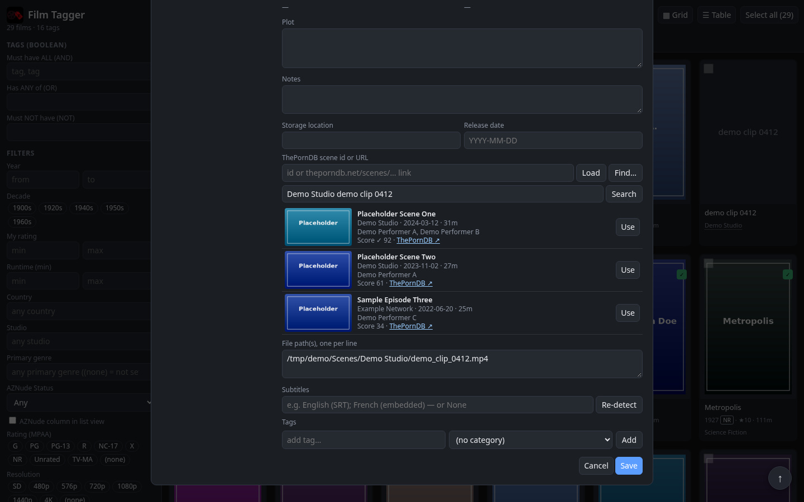

<p align="center"></p>

# Film Tagger

**A private, local web app for cataloguing and richly tagging your own film collection.**
Point it at the folders where your video files live. It builds a searchable catalogue with posters and metadata, and lets you tag films in as much detail as you like, by hand or with help from AI. It runs entirely on your own computer. It is a catalogue, not a video player.

> **New to this? See [INSTALL.txt](INSTALL.txt)** for step-by-step Windows setup: download `FilmTaggerSetup.exe`, double-click, done. No Python install or admin rights needed.

## Features
### Library
- **Library scan:** recursively finds video files (mkv, mp4, avi, mov, wmv, m4v, mpg, ts, webm, vob, …) in any folders or drives and guesses the title and year from file or folder names. Rescans add new files and flag missing ones. Film libraries are **read-only**: those files are never moved, renamed or deleted. (Scenes libraries can rename files; see below.)
- **Removed items stay removed:** deleting a film or scene from the catalogue remembers it, so rescans skip it even if the file is later renamed or moved. *Show removed items* in Library & Settings lists them and can bring them back. The files themselves are never touched.
- **Rich records:** title, original and alternative titles, year, country, director, cast, studio, runtime, plot, poster, MPAA rating, resolution, subtitles, your 1–10 rating, watched flag, notes, storage location and file paths. Everything is editable.
- **Poster grid and sortable table**, fast with 10,000+ items. Scene cards show a studio line (studio · date · runtime).
- **Back to top:** a floating ↑ button appears in the grid, on person profiles and in long dialogs once you scroll down.
- **Backup / restore** as JSON or CSV.

### Tags, genres and search
- **Unlimited tags** with user-editable categories (Genre, Content, Themes, Mood, Setting, Era…), autocomplete and bulk add/remove. **The category you choose when adding a tag wins:** tag names are unique, so picking a different category moves that tag (for every film that has it). AI and CSV imports never change a tag's category.
- **Primary genre:** one main genre per film. In the Edit window it is free entry: pick from the list or type a new genre, which is then remembered for the list and the sidebar filter. A value you set by hand is locked; TMDB, *Fill missing Primary Genres* and smart tagging never overwrite it. Films in a *Classic Porn* folder are only ever auto-filled with Hardcore or Softcore, but you can set any value by hand.
- **Powerful search:** tag logic (ALL / ANY / NOT), text search in any field (accent-insensitive, including alternative titles), filters for year, decade, country, studio, primary genre, rating, runtime, watched, MPAA, resolution, subtitles and library folder. Searches can be saved, and Back/Forward history works for every filter.
- **Country, studio and decade links** show every film from that country, studio or decade. *Fill missing countries / studios* backfill older records from TMDB; values you edit are never overwritten.
- **Resolution** is auto-detected from the video files (ffprobe if installed, otherwise a built-in reader, otherwise the filename). **Subtitles** are detected from sidecar files (.srt, .ass, …) and embedded streams, and can be edited by hand.

### Scenes libraries and ThePornDB
Mark one or more folders as **Scenes libraries** (Library & Settings) for individual adult scenes instead of full-length films. Scenes never use TMDB; they are looked up on [ThePornDB](https://theporndb.net) and get Primary genre Hardcore.
- **Matching:** *Fetch* looks a scene up from its file name and applies confident matches automatically. **Find…** opens a candidate picker in the Edit window with the best matches (studio, date, runtime, performers and score) and a search box; **Use** applies one. A ThePornDB scene id or URL can also be pasted and loaded directly.
- **Review unmatched** lists every scene without a ThePornDB match with its top candidates, ready to pick.
- **Standard file names:** on *Use*, *Fetch*/*Load* and on **Save** (when studio, date, performers or title changed), the file and its same-name sidecars move to `<Studio>\<Studio> - YYYY-MM-DD - <Performers> - <Title>.<ext>`. Windows-illegal characters are removed, nothing is overwritten (` (2)` is appended), junk double extensions like `.mp4 - EPORN.mp4` are cleaned, the catalogue path is updated, an emptied old studio folder is removed (never `_No Studio`) and every move is logged to `_filmtagger_renames.csv` in the scenes folder. Scenes missing studio, date or title are left alone with a note.
- **Fix all file names** (Library & Settings) shows every planned rename (current → new) with a count first, then applies them with the same rules. Scenes with **`[Hold rename]`** in their notes are skipped (useful for shaky matches); remove the marker to include them again.

### People
- **Person profiles** for every actor, director, writer, producer, cinematographer and composer: photo, dates, bio and full filmography. Mainstream people come from TMDB ("You have 23 of 87", *Only films I have*); adult performers from ThePornDB (aliases, measurements, career, links), with the TMDB filmography kept when one exists.
- **Complete scene lists:** a performer's ThePornDB scenes are loaded page by page in the background (with progress) and cached, so performers with thousands of scenes show the true total. All your own scenes for that person are listed first as **In library**, linked by name, ThePornDB alias or scene id; the rest show 200 at a time with *Load more*. Scenes have their own *Only scenes I have* toggle.
- **Re-link** a person to a different ThePornDB performer or TMDB person by id or URL, or go back to automatic matching.
- **+ Person** adds someone by hand (name, photo, bio, links), for people neither service knows.

### Metadata and AI
- **Optional TMDB metadata:** with a free key it fetches posters, cast, plot, runtime, genres, studios and countries for one film or the whole library, and fills in MPAA ratings. Your own poster art (upload, drag-and-drop or URL) is never replaced.
- **Smart tagging (AI):** queue films and let an AI suggest tags and a primary genre. Every suggestion waits for your approval. Two ways:
  - **No key needed:** copy the ready-made prompt into any AI chatbot and paste back its JSON reply.
  - **Bring your own key:** connect any OpenAI-compatible API (OpenAI, OpenRouter, xAI, or local Ollama / LM Studio) for one-click "Tag now".
- **AZNude Status** per film (see below).

## Screenshots
All screenshots use a demo library of public-domain classic films and fictional placeholder people.

Library grid:


Table view with tags, genre, studio, resolution and MPAA columns:


Edit window for a film:


Edit window for a scene with the ThePornDB candidate picker (placeholder data):



Person profile (library-only mode, no TMDB key):


Library & Settings:


Scenes libraries, ThePornDB token and Fix all scene file names:


## Install
- **Windows (recommended):** download **`FilmTaggerSetup.exe`** from the [latest release](https://github.com/kylerhudson1975/film-tagger/releases/latest) and run it. It installs per user into `%LOCALAPPDATA%\Film Tagger` with a bundled Python 3.12, so no admin rights are needed. It adds Start Menu and (optionally) Desktop and sign-in shortcuts and an entry in *Apps* for uninstalling. Your library (`films.db` + `posters/`) lives in `%LOCALAPPDATA%\Film Tagger\data`. See [INSTALL.txt](INSTALL.txt).
  - Silent install: `FilmTaggerSetup.exe /S [/D=C:\path] [/NODESKTOP] [/STARTUP] [/PORT=5051]`. Silent uninstall (keeps the library): `uninstall.exe /S`.
  - Build the installer yourself on Linux: `installer/build_installer.sh` (needs `makensis`, `pip`, `curl`, `unzip`) → `dist/FilmTaggerSetup.exe`.
- **Windows (manual):** install Python 3, unzip the source, double-click `Install Film Tagger.bat`.
- **Mac / Linux:** `python3 -m pip install -r requirements.txt`, then `python3 app.py`, then open http://localhost:5050.

### Updating
Run the newer `FilmTaggerSetup.exe` over the existing install (close Film Tagger first, or use *Stop Film Tagger*). Your library and settings are kept, and the database is upgraded automatically on first start. For a source install, replace the program files (not `films.db` or `posters/`) and restart. A copy of `films.db` before updating is a good habit.

### ThePornDB API token (for Scenes libraries)
1. Create a free account at [theporndb.net](https://theporndb.net).
2. Open your profile → **API tokens** and create a token.
3. In Film Tagger open **Library & Settings → Scenes libraries**, paste the token and click *Save scenes settings*. Leave the field blank later to keep the saved token, or enter `-` to remove it.

The token is stored only in your local database. Never share it or put it in a screenshot or issue.

### TMDB API key (optional)
Free from themoviedb.org → Settings → API. Paste it under **Library & Settings → TMDB**. Without a key the app works offline with what is in your library.

## Smart tagging from the command line
```
python smarttag.py export-queue queue.json     # films you queued, as JSON
python smarttag.py import-tags tags.json       # AI reply -> pending tags for review
```
Reply format: `[{"film_id": 12, "tags": [{"name": "heist", "category": "Themes"}]}]`. See [SMART_TAG_PROMPT.txt](SMART_TAG_PROMPT.txt) for the full prompt.
REST equivalents: `GET /api/queue/export`, `POST /api/queue/import`, `GET /api/pending`, `POST /api/pending/review`.

## Privacy
- Everything stays on your computer in one SQLite file (`films.db`, plus a `posters/` folder for custom art). There is no account, telemetry or cloud service.
- The app only listens on `localhost` and rejects requests from other websites.
- Network requests only happen when **you** use them:
  - TMDB lookups, if you add a TMDB key;
  - ThePornDB lookups for Scenes libraries and adult performers, if you add a ThePornDB token;
  - your chosen AI provider, if you set one up. Only the film's title, year, director, file path, a short plot and its existing tags are sent.
- API keys are stored only in your local database.

## Tech
Python 3 + Flask + SQLite, with a single-page HTML/JS front end. There is no build step, and Flask is the only required dependency (ffprobe is used for resolution and subtitle detection if installed).

## License
[MIT](LICENSE) © 2026 Kyle R. Hudson & Grok Bot

## AZNude Status

Each film has an **AZNude Status**: Hardcore, Softcore, Not found, or Unchecked (blank). It is shown in the Edit
window under Primary genre (with the date checked and a link to the AZNude page if known) and can be set by hand;
a hand-set value is never overwritten by imports. It can be filtered in the sidebar and shown as an optional list
column. It **never** changes Primary genre or tags.

The **✨ AZNude Status** button (Edit window, or right-click a film) adds the film to a separate AZNude queue.
The check itself happens outside the app:

    python smarttag.py export-aznude-queue aznude_queue.json
    python smarttag.py import-aznude results.json

`results.json` is a list of `{"film_id": 12, "status": "Hardcore" | "Softcore" | "Not found" | null, "url": "...", "note": "..."}`.
Imported films are removed from the AZNude queue. API: `POST /api/films/<id>/aznude` with
`{"status", "url", "note", "manual": false, "force": false}`.
